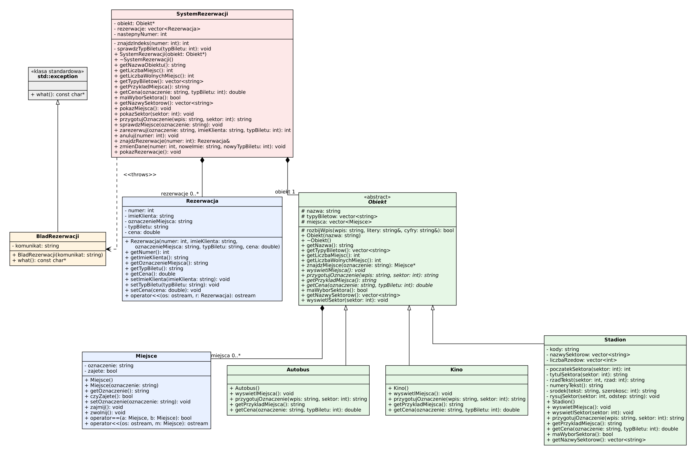

# System rezerwacji miejsc

Program konsolowy w C++ do rezerwowania miejsc w **autobusie**, **kinie** i na **stadionie**.
Projekt korzysta z programowania obiektowego: klas, enkapsulacji, dziedziczenia, polimorfizmu,
wyjątków i przeciążania operatorów.

## Funkcjonalności

- wybór typu miejsca (autobus, kino, stadion) i możliwość powrotu do tego wyboru
- plan miejsc: `[o]` wolne, `[x]` zajęte
- rezerwacja miejsca (imię klienta + rodzaj biletu), z ceną zależną od obiektu, rodzaju biletu
  i (na stadionie) sektora
- anulowanie rezerwacji, lista rezerwacji z łączną wartością
- wyszukiwanie rezerwacji po numerze i zmiana jej danych (imię, bilet)
- `4a` i `a4` to to samo miejsce; zły wpis od razu daje błąd i prosi o poprawkę
- na stadionie najpierw wybór sektora, potem miejsca w sektorze
- rezerwacje każdego obiektu są pamiętane do końca działania programu (po powrocie do wyboru
  typu miejsca nie znikają)

## Obiekty

| | Autobus | Kino | Stadion |
|---|---|---|---|
| Liczba miejsc | 28 | 150 | 400 |
| Układ | 7 rzędów po 4 miejsca (A-D), przejście między B i C | 15 rzędów (A-O) po 10 miejsc, 3 sektory po 5 rzędów | 5 sektorów wokół boiska |
| Oznaczenie miejsca | `4C` (rząd 4, siedzenie C) | `C8` (rząd C, miejsce 8) | `N-C7` (sektor N, rząd C, miejsce 7) |
| Rodzaje biletów | normalny, ulgowy | normalny, ulgowy, dla dzieci, dla seniorów | normalny, ulgowy, dla dzieci |

Sektory stadionu: `N` Trybuna Północna (100 miejsc), `W` Zachodnia (100), `E` Wschodnia (100),
`S` Południowa (50), `G` Sektor Gości (50).

### Ceny biletów

| Obiekt | Cena bazowa (bilet normalny) | Ulgi |
|---|---|---|
| Autobus | 12.00 zł | ulgowy: 50% ceny |
| Kino | 28.00 zł | ulgowy -20%, dla dzieci -40%, dla seniorów -30% |
| Stadion | zależy od sektora: N 70 zł, W i E 90 zł, S 60 zł, G 50 zł | ulgowy -30%, dla dzieci -50% |

## Struktura projektu

```
system-rezerwacji/
├── include/                pliki nagłówkowe (.h)
│   ├── Miejsce.h
│   ├── Rezerwacja.h
│   ├── Obiekt.h
│   ├── Autobus.h
│   ├── Kino.h
│   ├── Stadion.h
│   ├── SystemRezerwacji.h
│   └── BladRezerwacji.h
├── src/                    pliki implementacji (.cpp) i main.cpp
├── docs/
│   └── uml.png             schemat klas UML
├── .vscode/tasks.json      budowanie projektu w VS Code
├── .gitignore
└── README.md
```

## Architektura

### Schemat klas UML



Na schemacie wypełnione romby oznaczają **kompozycję** (`SystemRezerwacji` jest właścicielem
obiektu i rezerwacji, `Obiekt` jest właścicielem miejsc), puste trójkąty to **dziedziczenie**,
a przerywana strzałka to zależność (system rzuca wyjątek `BladRezerwacji`).
Agregacji w projekcie nie ma, bo żadna klasa nie przechowuje obiektu, którego nie jest właścicielem.
Operatory `==` i `<<` to funkcje nieskładowe, dopisane przy klasach, których dotyczą.
Wskaźnik `Obiekt*` w `SystemRezerwacji` jest właścicielem obiektu: system usuwa go w destruktorze,
a kopiowanie systemu jest zablokowane (`= delete`).

### Klasy

| Klasa | Zadanie |
|---|---|
| `Miejsce` | Jedno miejsce: oznaczenie i informacja, czy jest zajęte. |
| `Rezerwacja` | Dane rezerwacji: numer, imię klienta, miejsce, rodzaj biletu i cena. |
| `Obiekt` | Klasa abstrakcyjna: nazwa, rodzaje biletów i lista miejsc. Wspólna baza dla autobusu, kina i stadionu. |
| `Autobus`, `Kino`, `Stadion` | Klasy pochodne. Każda ma własny układ miejsc, sposób rysowania planu, ceny i rodzaje biletów. |
| `SystemRezerwacji` | Zarządza miejscami i rezerwacjami: rezerwowanie, anulowanie, wyszukiwanie, zmiana danych. |
| `BladRezerwacji` | Własny wyjątek (dziedziczy po `std::exception`). |

### Zastosowane mechanizmy

- **Enkapsulacja:** pola są `private` (lub `protected` w `Obiekt`), dostęp przez gettery i settery.
- **Dziedziczenie i polimorfizm:** `SystemRezerwacji` trzyma wskaźnik `Obiekt*`, który wskazuje na
  autobus, kino albo stadion. Wywołania `wyswietlMiejsca()`, `getCena()`, `przygotujOznaczenie()`
  i `getPrzykladMiejsca()` (czysto wirtualne w `Obiekt`) trafiają do metody właściwej klasy
  pochodnej (`override`). Dzięki temu cały kod rezerwacji jest wspólny dla trzech obiektów.
- **Metody `const`:** gettery, metody wyświetlające i wyszukujące, które nie zmieniają obiektu
  (`znajdzMiejsce` ma dwie wersje: zwykłą i `const`).
- **Przeciążone operatory:**
  - `operator<<` dla `Miejsce` wypisuje `[o]` lub `[x]` (używany w planach miejsc),
  - `operator<<` dla `Rezerwacja` wypisuje rezerwację w jednej linijce (lista i wyszukiwanie),
  - `operator==` dla `Miejsce` porównuje oznaczenia (używany w wyszukiwaniu miejsca).
- **Wyjątki:** `SystemRezerwacji` rzuca `BladRezerwacji`, gdy miejsce nie istnieje lub jest zajęte,
  wpis ma zły format, nie ma rezerwacji o danym numerze albo rodzaj biletu jest zły.
  W `main.cpp` wyjątki są łapane: przy wpisywaniu miejsca (błąd i prośba o poprawkę) oraz w menu
  (komunikat zamiast zakończenia programu).

## Kompilacja i uruchomienie

Potrzebny jest kompilator `g++` z obsługą C++11 lub nowszego.

**VS Code:** otwórz folder `system-rezerwacji`, naciśnij **Ctrl+Shift+B** (zadanie z `.vscode/tasks.json`),
a potem w terminalu uruchom program.

**Terminal (Linux, macOS):**
```
g++ -Iinclude src/*.cpp -o rezerwacje
./rezerwacje
```

**Terminal (Windows, PowerShell):**
```
g++ -Iinclude src/main.cpp src/Miejsce.cpp src/Rezerwacja.cpp src/Obiekt.cpp src/Autobus.cpp src/Kino.cpp src/Stadion.cpp src/SystemRezerwacji.cpp src/BladRezerwacji.cpp -o rezerwacje
.\rezerwacje.exe
```

## Obsługa programu

Na starcie wybierasz typ miejsca (`0` kończy program). Po wyborze obiektu pojawia się menu
(`0` wraca do wyboru typu miejsca):

```
=== SYSTEM REZERWACJI (Autobus) ===
Wolnych miejsc: 28 z 28
1. Pokaz miejsca
2. Zarezerwuj miejsce
3. Anuluj rezerwacje
4. Pokaz rezerwacje
5. Szukaj rezerwacji po numerze
6. Zmien dane rezerwacji
0. Wroc do wyboru miejsca
```

Przy wpisywaniu miejsca `0` wraca do menu. Wielkość liter, spacje i kolejność nie mają znaczenia
(`4a` = `a4` = `4A`).

## Przykłady działania

### 1. Autobus: zły wpis, miejsce zajęte, lista rezerwacji

Zły wpis od razu daje błąd, `a4` jest rozpoznane jako miejsce `4A`, a próba zarezerwowania
zajętego miejsca kończy się komunikatem.

```
=== SYSTEM REZERWACJI ===
Jaki typ miejsca chcesz zarezerwowac?
1. Autobus
2. Kino
3. Stadion
0. Wyjscie
Twoj wybor: 1

=== SYSTEM REZERWACJI (Autobus) ===
Wolnych miejsc: 28 z 28
[menu opcji 1-6 i 0]
Twoj wybor: 2

=== AUTOBUS - plan miejsc ===
          PRZOD
     A   B       C   D
1   [o] [o]     [o] [o] 
2   [o] [o]     [o] [o] 
3   [o] [o]     [o] [o] 
4   [o] [o]     [o] [o] 
5   [o] [o]     [o] [o] 
6   [o] [o]     [o] [o] 
7   [o] [o]     [o] [o] 

[o] - wolne, [x] - zajete

Podaj miejsce, np. 4C (0 = wroc do menu): 9z
BLAD: takie miejsce nie istnieje, sprobuj jeszcze raz.

Podaj miejsce, np. 4C (0 = wroc do menu): a4
Podaj imie klienta: Jan Kowalski

Wybierz rodzaj biletu:
1. Bilet normalny - 12.00 zl
2. Bilet ulgowy - 6.00 zl
Twoj wybor: 2

Zarezerwowano!
Rezerwacja nr 1 | Klient: Jan Kowalski | Miejsce: 4A | Bilet ulgowy | 6.00 zl

=== SYSTEM REZERWACJI (Autobus) ===
Wolnych miejsc: 27 z 28
[menu opcji 1-6 i 0]
Twoj wybor: 2

[... plan miejsc ...]

Podaj miejsce, np. 4C (0 = wroc do menu): 4A
BLAD: miejsce 4A jest juz zajete, sprobuj jeszcze raz.

Podaj miejsce, np. 4C (0 = wroc do menu): 0

=== SYSTEM REZERWACJI (Autobus) ===
Wolnych miejsc: 27 z 28
[menu opcji 1-6 i 0]
Twoj wybor: 4

=== LISTA REZERWACJI ===
Rezerwacja nr 1 | Klient: Jan Kowalski | Miejsce: 4A | Bilet ulgowy | 6.00 zl
Razem rezerwacji: 1, laczna wartosc: 6.00 zl

=== SYSTEM REZERWACJI (Autobus) ===
Wolnych miejsc: 27 z 28
[menu opcji 1-6 i 0]
Twoj wybor: 0

=== SYSTEM REZERWACJI ===
Jaki typ miejsca chcesz zarezerwowac?
1. Autobus
2. Kino
3. Stadion
0. Wyjscie
Twoj wybor: 0

Do widzenia!
```

### 2. Stadion: wybór sektora, potem miejsca

Na stadionie najpierw wybieramy sektor, a potem miejsce w nim. Cena zależy od sektora
(w sektorze S bilet ulgowy kosztuje 42.00 zł).

```
=== SYSTEM REZERWACJI ===
Jaki typ miejsca chcesz zarezerwowac?
1. Autobus
2. Kino
3. Stadion
0. Wyjscie
Twoj wybor: 3

=== SYSTEM REZERWACJI (Stadion) ===
Wolnych miejsc: 400 z 400
[menu opcji 1-6 i 0]
Twoj wybor: 2

=== STADION - plan miejsc ===
400 miejsc, 5 sektorow

                             TRYBUNA POLNOCNA (N)      
                          1  2  3  4  5  6  7  8  9 10 
                       A [o][o][o][o][o][o][o][o][o][o]
                       B [o][o][o][o][o][o][o][o][o][o]
                       C [o][o][o][o][o][o][o][o][o][o]
                       D [o][o][o][o][o][o][o][o][o][o]
                       E [o][o][o][o][o][o][o][o][o][o]
                       F [o][o][o][o][o][o][o][o][o][o]
                       G [o][o][o][o][o][o][o][o][o][o]
                       H [o][o][o][o][o][o][o][o][o][o]
                       I [o][o][o][o][o][o][o][o][o][o]
                       J [o][o][o][o][o][o][o][o][o][o]

     TRYBUNA ZACHODNIA (W)                         TRYBUNA WSCHODNIA (E)      
   1  2  3  4  5  6  7  8  9 10                  1  2  3  4  5  6  7  8  9 10 
A [o][o][o][o][o][o][o][o][o][o]  +--------+  A [o][o][o][o][o][o][o][o][o][o]
B [o][o][o][o][o][o][o][o][o][o]  | +----+ |  B [o][o][o][o][o][o][o][o][o][o]
C [o][o][o][o][o][o][o][o][o][o]  | |    | |  C [o][o][o][o][o][o][o][o][o][o]
D [o][o][o][o][o][o][o][o][o][o]  |        |  D [o][o][o][o][o][o][o][o][o][o]
E [o][o][o][o][o][o][o][o][o][o]  | BOISKO |  E [o][o][o][o][o][o][o][o][o][o]
F [o][o][o][o][o][o][o][o][o][o]  |--(  )--|  F [o][o][o][o][o][o][o][o][o][o]
G [o][o][o][o][o][o][o][o][o][o]  |        |  G [o][o][o][o][o][o][o][o][o][o]
H [o][o][o][o][o][o][o][o][o][o]  | |    | |  H [o][o][o][o][o][o][o][o][o][o]
I [o][o][o][o][o][o][o][o][o][o]  | +----+ |  I [o][o][o][o][o][o][o][o][o][o]
J [o][o][o][o][o][o][o][o][o][o]  +--------+  J [o][o][o][o][o][o][o][o][o][o]

     TRYBUNA POLUDNIOWA (S)                           SEKTOR GOSCI (G)        
   1  2  3  4  5  6  7  8  9 10                  1  2  3  4  5  6  7  8  9 10 
A [o][o][o][o][o][o][o][o][o][o]              A [o][o][o][o][o][o][o][o][o][o]
B [o][o][o][o][o][o][o][o][o][o]              B [o][o][o][o][o][o][o][o][o][o]
C [o][o][o][o][o][o][o][o][o][o]              C [o][o][o][o][o][o][o][o][o][o]
D [o][o][o][o][o][o][o][o][o][o]              D [o][o][o][o][o][o][o][o][o][o]
E [o][o][o][o][o][o][o][o][o][o]              E [o][o][o][o][o][o][o][o][o][o]

[o] - wolne, [x] - zajete

Wybierz sektor:
1. TRYBUNA POLNOCNA (N) - 100 miejsc
2. TRYBUNA ZACHODNIA (W) - 100 miejsc
3. TRYBUNA WSCHODNIA (E) - 100 miejsc
4. TRYBUNA POLUDNIOWA (S) - 50 miejsc
5. SEKTOR GOSCI (G) - 50 miejsc
0. Wroc do menu
Twoj wybor: 4

     TRYBUNA POLUDNIOWA (S)     
   1  2  3  4  5  6  7  8  9 10 
A [o][o][o][o][o][o][o][o][o][o]
B [o][o][o][o][o][o][o][o][o][o]
C [o][o][o][o][o][o][o][o][o][o]
D [o][o][o][o][o][o][o][o][o][o]
E [o][o][o][o][o][o][o][o][o][o]

[o] - wolne, [x] - zajete

Podaj miejsce, np. C7 (0 = wroc do menu): F1
BLAD: takie miejsce nie istnieje, sprobuj jeszcze raz.

Podaj miejsce, np. C7 (0 = wroc do menu): 3c
Podaj imie klienta: Ola

Wybierz rodzaj biletu:
1. Bilet normalny - 60.00 zl
2. Bilet ulgowy - 42.00 zl
3. Bilet dla dzieci - 30.00 zl
Twoj wybor: 2

Zarezerwowano!
Rezerwacja nr 1 | Klient: Ola | Miejsce: S-C3 | Bilet ulgowy | 42.00 zl

=== SYSTEM REZERWACJI (Stadion) ===
Wolnych miejsc: 399 z 400
[menu opcji 1-6 i 0]
Twoj wybor: 4

=== LISTA REZERWACJI ===
Rezerwacja nr 1 | Klient: Ola | Miejsce: S-C3 | Bilet ulgowy | 42.00 zl
Razem rezerwacji: 1, laczna wartosc: 42.00 zl

=== SYSTEM REZERWACJI (Stadion) ===
Wolnych miejsc: 399 z 400
[menu opcji 1-6 i 0]
Twoj wybor: 0

=== SYSTEM REZERWACJI ===
Jaki typ miejsca chcesz zarezerwowac?
1. Autobus
2. Kino
3. Stadion
0. Wyjscie
Twoj wybor: 0

Do widzenia!
```

### 3. Kino: błędy, zmiana i anulowanie rezerwacji

```
=== SYSTEM REZERWACJI ===
Jaki typ miejsca chcesz zarezerwowac?
1. Autobus
2. Kino
3. Stadion
0. Wyjscie
Twoj wybor: 2

=== SYSTEM REZERWACJI (Kino) ===
Wolnych miejsc: 150 z 150
[menu opcji 1-6 i 0]
Twoj wybor: 3

Podaj numer rezerwacji do anulowania.
Twoj wybor: 5

BLAD: nie ma rezerwacji o numerze 5

=== SYSTEM REZERWACJI (Kino) ===
Wolnych miejsc: 150 z 150
[menu opcji 1-6 i 0]
Twoj wybor: 2

[... plan miejsc kina ...]

Podaj miejsce, np. C8 (0 = wroc do menu): 8c
Podaj imie klienta: Anna

Wybierz rodzaj biletu:
1. Bilet normalny - 28.00 zl
2. Bilet ulgowy - 22.40 zl
3. Bilet dla dzieci - 16.80 zl
4. Bilet dla seniorow - 19.60 zl
Twoj wybor: 4

Zarezerwowano!
Rezerwacja nr 1 | Klient: Anna | Miejsce: C8 | Bilet dla seniorow | 19.60 zl

=== SYSTEM REZERWACJI (Kino) ===
Wolnych miejsc: 149 z 150
[menu opcji 1-6 i 0]
Twoj wybor: 6

Podaj numer rezerwacji do zmiany.
Twoj wybor: 1

Obecne dane:
Rezerwacja nr 1 | Klient: Anna | Miejsce: C8 | Bilet dla seniorow | 19.60 zl

Podaj nowe imie klienta: Anna Nowak

Wybierz rodzaj biletu:
1. Bilet normalny - 28.00 zl
2. Bilet ulgowy - 22.40 zl
3. Bilet dla dzieci - 16.80 zl
4. Bilet dla seniorow - 19.60 zl
Twoj wybor: 2

Dane rezerwacji zostaly zmienione:
Rezerwacja nr 1 | Klient: Anna Nowak | Miejsce: C8 | Bilet ulgowy | 22.40 zl

=== SYSTEM REZERWACJI (Kino) ===
Wolnych miejsc: 149 z 150
[menu opcji 1-6 i 0]
Twoj wybor: 5

Podaj numer rezerwacji.
Twoj wybor: 99


BLAD: nie ma rezerwacji o numerze 99

=== SYSTEM REZERWACJI (Kino) ===
Wolnych miejsc: 149 z 150
[menu opcji 1-6 i 0]
Twoj wybor: 3

Podaj numer rezerwacji do anulowania.
Twoj wybor: 1
Rezerwacja nr 1 zostala anulowana.

=== SYSTEM REZERWACJI (Kino) ===
Wolnych miejsc: 150 z 150
[menu opcji 1-6 i 0]
Twoj wybor: 0

=== SYSTEM REZERWACJI ===
Jaki typ miejsca chcesz zarezerwowac?
1. Autobus
2. Kino
3. Stadion
0. Wyjscie
Twoj wybor: 0

Do widzenia!
```